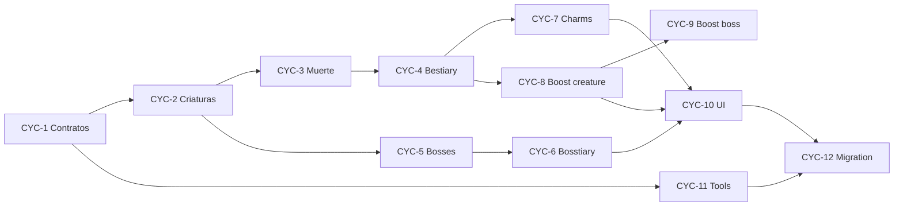

# Cyclopedia — Plan de implementación (CYC-1 … CYC-12)

**Prerequisito:** CYC-0 aprobado (este documento).  
**Reglas:** Cada fase deja el juego ejecutable; no mezclar fases; no TS/ESM; editar `dev.html` si hay scripts nuevos; no tocar `index.html`/`app.min.js` manualmente.

---

## CYC-0 — Auditoría y diseño

| | |
|--|--|
| **Objetivo** | Auditoría solo lectura + documentación |
| **Estado** | **Completado** (2026-11-21) |
| **Artefactos** | `docs/cyclopedia/*` |

---

## CYC-1 — Contratos y registros — **Completado** (2026-11-21)

| Campo | Detalle |
|-------|---------|
| **Objetivo** | Enums, contratos documentados en código stub, validación sin cambiar combate |
| **Alcance** | `js/data/cyclopedia-enums.js`, `js/data/cyclopedia-registry.js` (stubs que delegan a `G.CREATURES`), `G.Cyclopedia` facade lectura, ampliar `G.Bestiary.validate` hooks |
| **Fuera** | Migración criaturas, cambios spawn, UI |
| **Archivos** | `dev.html` (+2 scripts después `bestiary.js`), `js/data/bestiary.js` (import enums), `tools/validate-mvp.js` |
| **Símbolos** | `G.Cyclopedia`, `G.CYCLOPEDIA_SCHEMA` |
| **Dependencias** | CYC-0 |
| **Pasos** | 1) Añadir enums ROLE/BEHAVIOUR/… 2) Registry `listCreatures()` 3) Facade `getDefinition(id)` 4) Validator IDs duplicados 5) `node tools/validate-mvp.js` |
| **Pruebas** | Boot `dev.html?dev`; NEED sin roturas; validator OK |
| **Aceptación** | Sin ReferenceError; `G.Cyclopedia.getDefinition('cat')` devuelve objeto estable |
| **Riesgos** | Orden scripts |
| **Rollback** | Revertir 2 archivos + dev.html |
| **Siguiente** | CYC-2 cuando enums aprobados |

---

## CYC-2 — Normalización de criaturas y spawn por bandas (D7) — **Completado** (2026-11-21)

| Campo | Detalle |
|-------|---------|
| **Objetivo** | HP/dmg declarados = combate; `pickInHpBand(t)` sustituye curva `TIER_STATS`+`hpMulRun` como eje principal |
| **Alcance** | `defineCreature()`; migrar 15 criaturas; `H_target(t)` / `D_target(t)` en `mvp-config.js`; `defFor` desde `creature.hp`; bosses elegibles `spawnModes: hp_band` |
| **Fuera** | Import masivo 2000+ criaturas (preparar validador); boss phases data-driven |
| **Archivos** | `creatures.js`, `neutral-roster.js`, `spawner.js`, `mvp-config.js`, `bestiary-ui.js`, `tools/validate-*` |
| **Contratos** | `CreatureDefinition`, `CreatureSpawnProfile` (bandas), §2.1 estándar |
| **Pruebas** | t=0 spawns ~20 HP; barra = ficha; validador cubre tramos run |
| **Aceptación** | HP runtime = declarado (± redondeo); sin inflado 1.6× cap; curva desafiante acordada |
| **Riesgos** | MVP pool pequeño hasta más IDs — fallbacks obligatorios |
| **Rollback** | Flag `SPAWN_MODE: legacy_tier_scale` |

---

## CYC-3 — Pipeline muerte y progreso — **Completado** (2026-11-21)

| Campo | Detalle |
|-------|---------|
| **Objetivo** | Contadores run (`killsThisRun` en memoria + evento), `runsEncountered++` al primer spawn visible, atribución unificada |
| **Alcance** | `bestiary.js` system, `EnemyMgr` spawn hook, opcional `Progress.kill` delega a bestiary |
| **Fuera** | Nuevas recompensas |
| **Archivos** | `js/systems/bestiary.js`, `js/entities/enemy.js` (spawn flag), `js/ui/bestiary-run-ui.js` |
| **Pruebas** | 3 kills misma criatura; segunda run sin doble count; `runsEncountered` |
| **Aceptación** | `tryCreditDefeat` idempotente; burn death credit |

---

## CYC-4 — Bestiary (etapas, ocurrencia) — **Completado** (2026-11-21)

| Campo | Detalle |
|-------|---------|
| **Objetivo** | Ocurrencia data; etapas con nombres originales; revelación alineada requisito usuario |
| **Alcance** | `bestiary.js` data `OCCURRENCE_SCALE`, UI labels, `reveal` loot tiers |
| **Fuera** | Daily boost |
| **Archivos** | `bestiary.js`, `bestiary-ui.js`, `lang-en.js` |
| **Pruebas** | UI por etapa; filtros ocurrencia |
| **Aceptación** | Completar cat → charm points una vez; umbrales coherentes con 10–15 min |

---

## CYC-5 — Normalización bosses — **Completado** (2026-11-21)

| Campo | Detalle |
|-------|---------|
| **Objetivo** | `BossDefinition` para `black_knight`, `orshabaal`; extraer kit Orshabaal a tabla ataques |
| **Alcance** | `js/data/bosses.js` nuevo; `enemy.js` consume `BossRegistry.getKit(id)` |
| **Fuera** | Archfoe content |
| **Pruebas** | Boss dev spawn; fases transición |
| **Aceptación** | Sin `isOrshabaal()` lógica de ataques fuera registry (puede quedar detector delegado) |

---

## CYC-6 — Bosstiary — **Completado** (2026-11-21)

| Campo | Detalle |
|-------|---------|
| **Objetivo** | Progreso boss: primera victoria flag, boss points opcionales, tab UI Bosstiary |
| **Alcance** | Save fields, UI tab, categorías Bane/Archfoe/Nemesis copy original TS |
| **Fuera** | Rift re-enable |
| **Pruebas** | Kill sentinel + final boss; persistencia |

---

## CYC-7 — Charms — **Completado** (2026-11-21)

| Campo | Detalle |
|-------|---------|
| **Objetivo** | Catálogo MVP ampliado (6–8 charms), reglas anti-recursión, telemetría |
| **Alcance** | `bestiary.js` CHARMS, `bestiary-charms.js`, economía puntos |
| **Fuera** | Asignación por criatura |
| **Pruebas** | Matriz charms; boss cap wound |

---

## CYC-8 — Daily Boosted Creature — **Completado** (2026-11-21)

| Campo | Detalle |
|-------|---------|
| **Objetivo** | Rotación offline, modificadores spawn/XP/bestiary |
| **Alcance** | `js/systems/daily-boost.js`, save `cyclopedia.daily`, HUD menú |
| **Pruebas** | `tools/validate-daily-boost.js` (matriz DB01–DB08) |

---

## CYC-9 — Daily Boosted Boss — **Completado** (2026-11-21)

| Campo | Detalle |
|-------|---------|
| **Objetivo** | Rotación boss independiente; señal UI; bonus bosstiary |
| **Alcance** | Integración spawner (peso extra, no garantizar Nemesis) |
| **Pruebas** | `validate-daily-boost.js` DB09; pool único boss |

---

## CYC-10 — UI Cyclopedia — **Completado** (2026-11-21)

| Campo | Detalle |
|-------|---------|
| **Objetivo** | Tabs Bestiary / Bosstiary / Charms; paneles daily; búsqueda |
| **Alcance** | `dev.html` estructura, `bestiary-ui.js` refactor mínimo |
| **Fuera** | Arte final sprites |
| **MVP UI** | Tabs + filtros + detail + daily panel + search |
| **Posterior** | Podiums, historial gráfico |
| **Descartado** | Items/Map cyclopedia clases Tibia |

---

## CYC-11 — Herramientas de autoría — **Completado** (2026-11-21)

| Campo | Detalle |
|-------|---------|
| **Objetivo** | Validadores, plantillas, workflows `NEW_*_INTAKE.md` ejecutables |
| **Alcance** | `validate-cyclopedia.js`, `report-cyclopedia-content.js`, `templates/creature.template.js` |
| **Pruebas** | Fixture `__cyclopedia_fixture_invalid__` en validate-cyclopedia |

---

## CYC-12 — Migración y validación integral — **Completado** (2026-11-21)

| Campo | Detalle |
|-------|---------|
| **Objetivo** | `schemaVersion` 2, `save.cyclopedia`, migración desde `bestiary` v1, checklist completa |
| **Alcance** | `db.js`, `migrateCyclopediaSave`, `TEST_MATRIX` T05–T06 |
| **Pruebas** | `validate-cyclopedia-migration.js` |
| **Aceptación** | Re-init sin doble crédito de kills; cyclopedia corrupta → saneada |

---

## Dependencias entre fases

---

## Verificación transversal (cada fase)

1. `dev.html?dev` boot sin errores consola.  
2. Run 60s → menú → segunda run 60s.  
3. `node tools/validate-mvp.js` (si aplica fase).  
4. Guest + cuenta local save (si toca persistencia).